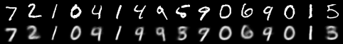
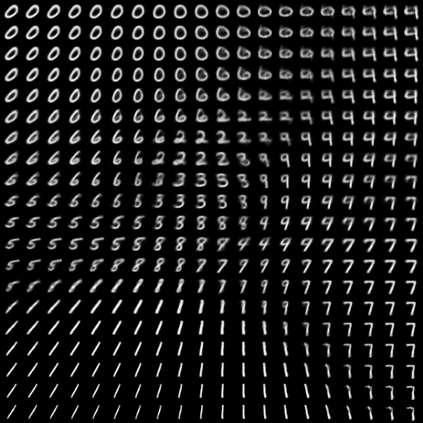

# Training AI

Five small AI projects, one for each of the main ways to train an AI. Each folder has its own `NOTES.md` explaining how it works, what I tried and what happened. See [AI Training Methods](<AI Training Methods/TRAINING_METHODS.md>) for an overview of the methods in general.

## Results

| Project | Training method | What it learned | Result |
|---|---|---|---|
| [Digit recognizer](NOTES.md) | Supervised | Read handwritten digits from 60,000 labeled examples | **99.29%** test accuracy |
| [Handwriting fine-tune](NOTES.md#fine-tuning-experiment-teaching-it-my-handwriting) | Transfer learning | Adapt the digit model to my own handwriting | **90.0% → 93.3%** on my drawings |
| [Tiny GPT](language_model/NOTES.md) | Self-supervised | Write Shakespeare-style text, one character at a time | Val loss **1.649** |
| [VAE](autoencoder/NOTES.md) | Unsupervised / generative | Compress a digit to just 2 numbers, then draw new ones | Test loss **143.4** |
| [Snake AI](snake_rl/NOTES.md) | Reinforcement learning | Play Snake by trial and error, from rewards alone | **0.2 → 20.1** apples per game |

### 1. Digit recognizer (supervised)
A small convolutional neural network (421k parameters) trained from scratch on MNIST. It trained for 10 epochs in about 2 minutes on an Apple Silicon GPU, and the script keeps only the best epoch.

| Run | Epochs | Test accuracy |
|---|---|---|
| 1 | 3 | 98.87% |
| 2 | 10 (best epoch kept) | **99.29%** |

### 2. Fine-tuning on my handwriting (transfer learning)
I drew 123 digits of my own, then retrained only the last layers of the digit model (conv layers frozen, learning rate 1e-4). Thirty drawings were held out for testing.

| | Before | After |
|---|---|---|
| My handwriting (30 held-out drawings) | 90.0% | **93.3%** |
| All 13 of my crossed 7s | 11/13 | **13/13** |
| MNIST (original test set) | 99.29% | 98.63% |

Before fine-tuning, the model read my crossed 7 as a 2 with 100% confidence, because MNIST writers rarely cross their 7s. Fine-tuning fixed that, at the cost of a small amount of *catastrophic forgetting* on MNIST.

### 3. Tiny GPT (self-supervised)
A character-level transformer (about 800k parameters, the same architecture as ChatGPT at a tiny scale) trained on about 1 MB of Shakespeare for 3,000 steps (344s).

> *"If the treath ensent sir; take it and I say;"*

It learned character names (CORIOLANUS, LUCIO, ANGELO) and play formatting, but invents a lot of words. Validation loss was still falling, so more training would help.

### 4. Variational autoencoder (unsupervised)
It squeezes each 28×28 digit (784 pixels) down to **just 2 numbers**, then rebuilds it. It was never told which digit is which.

**Top: real digits. Bottom: rebuilt from 2 numbers each.**



**The whole 2-D "digit space."** Every point is a digit it can draw, and the digits morph smoothly into each other:



### 5. Snake AI (reinforcement learning)
Tabular Q-learning. The snake starts out moving randomly, gets +10 for an apple and −10 for dying, and learns a strategy over 3,000 games (about 2 seconds of training).

| Games played | Exploration (ε) | Avg apples (last 100 games) |
|---|---|---|
| 250 | 0.83 | 0.4 |
| 1,000 | 0.34 | 2.5 |
| 1,500 | 0.01 | 11.7 |
| 2,000 | 0.01 | **18.2** |

Over 200 test games, the trained agent averaged **20.1** (best 39) and a random agent averaged **0.2**. It levels off around 20 because it can only sense one square around its head, so it eventually traps itself inside its own body:

```
. . . o o o o o o . . .
. . . o o . . o o . . .
. . o o o . . o . . . .
. . o @ o . . o . . . .     @ = head, boxed in
* . o o o o o o . . . .     * = the apple it wanted
```

## Quick start
```bash
python3 -m venv .venv && .venv/bin/pip install -r requirements.txt

# Digit recognizer + handwriting fine-tune
.venv/bin/python train.py      # train from scratch, saves digit_model.pt
.venv/bin/python predict.py    # watch it guess random test digits
.venv/bin/python draw.py       # draw your own digits at http://localhost:8000
.venv/bin/python finetune.py   # fine-tune on your drawings, saves my_model.pt

# Other projects
.venv/bin/python language_model/train_lm.py   # tiny GPT (~7 min)
.venv/bin/python autoencoder/train_vae.py     # VAE (~1 min)
.venv/bin/python snake_rl/train_q.py          # Snake AI (~2 s)
.venv/bin/python snake_rl/play.py             # watch the snake play
```
