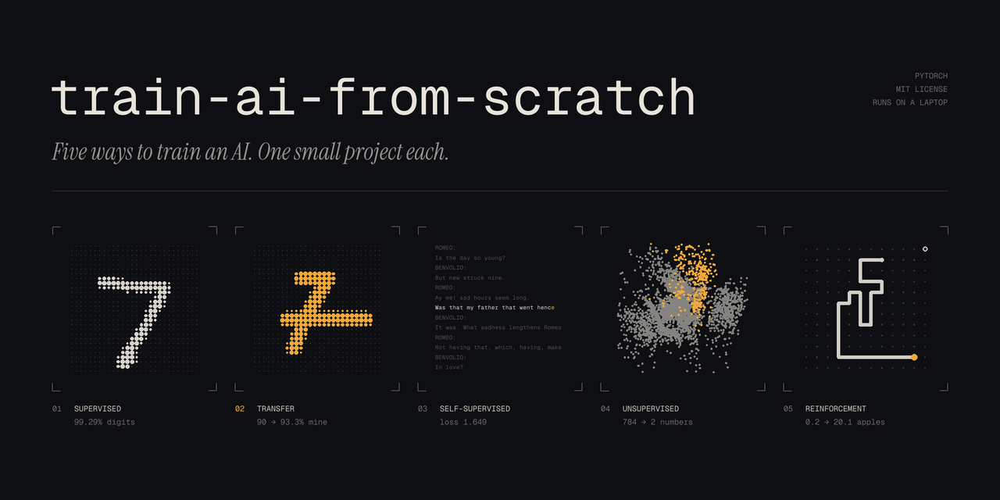
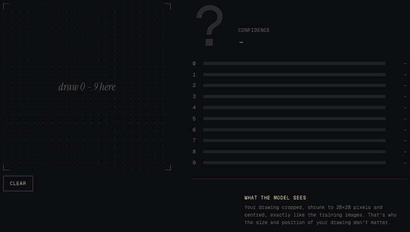
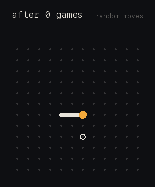

<p align="center">
  
</p>

<p align="center">
  <a href="https://github.com/Kiddo4993/train-ai-from-scratch/actions/workflows/tests.yml"></a>
  <a href="LICENSE"></a>
  
  
  
  <a href="https://kiddo4993.github.io/train-ai-from-scratch/"></a>
</p>

<p align="center">
  <b>Learn the five main ways AI is trained by training five real models yourself, each in minutes, on a laptop.</b>
</p>

<p align="center">
  <a href="https://kiddo4993.github.io/train-ai-from-scratch/"><b>▶ Try the live demo</b></a>: draw a digit and watch the network read it, then watch the Snake AI play. Nothing to install.
</p>

<p align="center">
  <a href="https://kiddo4993.github.io/train-ai-from-scratch/"></a>
</p>

---

Most "learn AI" material either stays theoretical or hides the training inside a framework call. This repo does neither. Each project is **one small, readable PyTorch script** (or plain Python) that you run, watch learn, and then break on purpose with the experiments in its notes.

| # | Project | Training method | What it learns | Result | Train time* | Notebook |
|:-:|---|---|---|---|---|:-:|
| 1 | [**Digit recognizer**](NOTES.md) | Supervised | Read handwritten digits from 60k labeled examples | **99.29%** test accuracy | ~2 min | <a href="https://colab.research.google.com/github/Kiddo4993/train-ai-from-scratch/blob/main/notebooks/01_digit_recognizer.ipynb"></a> |
| 2 | [**Handwriting fine-tune**](NOTES.md#fine-tuning-experiment-teaching-it-my-handwriting) | Transfer learning | Adapt model #1 to *your* handwriting from ~100 drawings | **90.0% → 93.3%** | seconds | <a href="https://colab.research.google.com/github/Kiddo4993/train-ai-from-scratch/blob/main/notebooks/02_handwriting_finetune.ipynb"></a> |
| 3 | [**Tiny GPT**](language_model/NOTES.md) | Self-supervised | Write Shakespeare-style text, one character at a time | val loss **1.649** | ~6 min | <a href="https://colab.research.google.com/github/Kiddo4993/train-ai-from-scratch/blob/main/notebooks/03_tiny_gpt.ipynb"></a> |
| 4 | [**VAE**](autoencoder/NOTES.md) | Unsupervised / generative | Squeeze a digit into **2 numbers**, then dream up new ones | test loss **143.4** | ~1 min | <a href="https://colab.research.google.com/github/Kiddo4993/train-ai-from-scratch/blob/main/notebooks/04_vae.ipynb"></a> |
| 5 | [**Snake AI**](snake_rl/NOTES.md) | Reinforcement learning | Play Snake from rewards alone, with no examples | **0.2 → 20.1** apples/game | ~2 sec | <a href="https://colab.research.google.com/github/Kiddo4993/train-ai-from-scratch/blob/main/notebooks/05_snake_q_learning.ipynb"></a> |
| 6 | [**Snake AI, deep**](snake_dqn/NOTES.md) | Deep RL (DQN) | Same game, but a neural network replaces the table | **44.3** apples/game (2× the table) | ~3 min | <a href="https://colab.research.google.com/github/Kiddo4993/train-ai-from-scratch/blob/main/notebooks/06_snake_dqn.ipynb"></a> |

<sub>*Measured on an Apple Silicon laptop. Works on CPU, NVIDIA (CUDA) and Apple (MPS). Trained models are included, so you can try every demo without training anything. Project 6 is a bonus that extends project 5.</sub>

## Quick start

```bash
git clone https://github.com/Kiddo4993/train-ai-from-scratch.git
cd train-ai-from-scratch
python3 -m venv .venv && source .venv/bin/activate
pip install -r requirements.txt
```

Then pick any project. They're independent:

```bash
python snake_rl/train_q.py && python snake_rl/play.py   # watch an AI learn Snake (fastest, start here)
python train.py && python predict.py                    # digit recognizer
python draw.py                                          # draw your own digits at http://localhost:8000
python finetune.py                                      # ...then fine-tune on them
python language_model/train_lm.py                       # tiny GPT
python language_model/generate.py                       # ...then make it write
python autoencoder/train_vae.py                         # VAE, saves images to autoencoder/samples/
python snake_dqn/train_dqn.py                           # deep Q-learning Snake
python snake_dqn/play.py --games 200 --compare          # ...DQN vs. Q-table vs. random
```

No setup at all? Every project has a **Colab notebook** (see the table) that runs free in your browser.

## What you'll learn

Each project's `NOTES.md` explains its concepts in plain language, records real results, and ends with experiments to try. A good path through them:

1. **Snake AI**: agents, rewards, exploration vs. exploitation, the Q-learning update. Pure Python with no ML library, so you can read every number it learns.
2. **Digit recognizer**: the training loop (forward pass, loss, backprop, optimizer step), convolutions, overfitting, train/test splits.
3. **Handwriting fine-tune**: transfer learning, freezing layers, catastrophic forgetting, why preprocessing matters.
4. **VAE**: learning without labels, latent spaces, the reparameterization trick, generating new data.
5. **Tiny GPT**: tokens, attention, causal masking, temperature sampling. The same architecture as ChatGPT, at 800k parameters.
6. **DQN Snake**: why deep RL replaces tables with networks, experience replay, target networks. It ties projects 1 and 5 together.

For the big picture, read [**AI Training Methods**](<AI Training Methods/TRAINING_METHODS.md>), a one-page map of every major training approach.

## Results

### Digit recognizer: 99.29% on handwriting it has never seen
A small convolutional network (421k parameters). The script saves only its best epoch, so later overfitting can't make the model worse.

| Run | Epochs | Test accuracy |
|---|---|---|
| 1 | 3 | 98.87% |
| 2 | 10 (best epoch kept) | **99.29%** |

### Handwriting fine-tune: teaching it a crossed 7
The base model read my crossed 7 as a **2 with 100% confidence**, because MNIST's writers rarely cross their 7s. I drew 123 digits of my own, then retrained only the classifier with the conv layers frozen.

| | Before | After |
|---|---|---|
| My handwriting (30 held-out drawings) | 90.0% | **93.3%** |
| All 13 of my crossed 7s | 11/13 | **13/13** |
| MNIST (catastrophic forgetting check) | 99.29% | 98.63% |

### Tiny GPT: Shakespeare, one character at a time
After 3,000 training steps (344s) it learned character names, line breaks and play formatting, though it still invents a lot of words:

> *"If the treath ensent sir; take it and I say;"*

### VAE: every digit, compressed to 2 numbers
**Top:** real digits. **Bottom:** rebuilt from just 2 numbers each.


The whole 2-D "digit space": every point is a digit the model can draw.


### Snake AI: from random moves to 20 apples



| Games played | Exploration (ε) | Avg apples (last 100 games) |
|---|---|---|
| 250 | 0.83 | 0.4 |
| 1,000 | 0.34 | 2.5 |
| 1,500 | 0.01 | 11.7 |
| 2,000 | 0.01 | **18.2** |

It plateaus around 20 because it can only sense one square around its head, so it eventually coils into a trap:

```
. . o o o . . o .
. . o @ o . . o .   @ = head, boxed in
* . o o o o o o .   * = the apple it wanted
```

<br clear="right">

### Deep Q-learning: breaking the plateau
Project 6 swaps the table for a neural network and gives the snake one new sense: **how much of the board it could still reach after each move**. That's a continuous number, which a table can't store but a network can. Head to head on the same 200 games:

| Agent | Avg apples | Best |
|---|---|---|
| Random | 0.1 | 1 |
| Q-table | 21.4 | 37 |
| **DQN** | **44.3** | **70** |

## Project structure

```
├── train.py, predict.py         # 1. digit recognizer
├── draw.py, finetune.py         # 2. handwriting fine-tune
├── language_model/              # 3. tiny GPT
├── autoencoder/                 # 4. VAE
├── snake_rl/                    # 5. Snake AI (Q-table)
├── snake_dqn/                   # 6. Snake AI (deep Q-learning)
├── notebooks/                   # one Colab notebook per project
├── docs/                        # the live demo (GitHub Pages)
├── scripts/                     # regenerate the demo weights and GIFs
├── AI Training Methods/         # one-page guide to every training method
├── tests/                       # checks each trained model still performs as reported
└── NOTES.md                     # notes for projects 1 and 2 (each folder has its own)
```

## Tests

On every push, the test suite loads each committed model and checks it still performs as reported (within a small margin):

```bash
pip install -r requirements-dev.txt
pytest
```

## FAQ

**Do I need a GPU?** No. Everything runs on a CPU; a GPU just makes projects 1, 3 and 4 faster. The Colab notebooks give you a free one. CUDA and Apple Silicon are picked up automatically.

**How much math do I need?** None to run the projects. The notes explain the ideas (gradients, loss, probability) in plain language as they come up.

**Why not use a high-level framework?** Because it hides the part you're here to learn. Every training loop in this repo is written out step by step.

**Can I use this for teaching?** Yes. It's MIT licensed. Each project fits in one class session, and the experiment lists make good homework.

## Contributing

Contributions are very welcome, especially **results from the experiments** in each `NOTES.md`, clearer explanations, and new projects that teach a method not covered yet (DQN, PPO, diffusion...). See [CONTRIBUTING.md](CONTRIBUTING.md).

If this repo helped you understand something, a ⭐ helps other learners find it.

## Acknowledgements

- [MNIST](https://en.wikipedia.org/wiki/MNIST_database) by Yann LeCun, Corinna Cortes and Christopher Burges
- [Tiny Shakespeare](https://github.com/karpathy/char-rnn) from Andrej Karpathy's char-rnn, whose [nanoGPT](https://github.com/karpathy/nanoGPT) and *Zero to Hero* series inspired the "small and readable" approach
- Built with [PyTorch](https://pytorch.org)

## License

[MIT](LICENSE) © 2026 Dylan Duan
